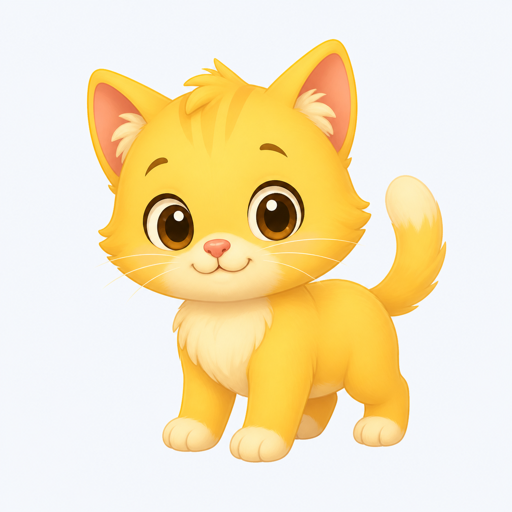

# 专注星伴：产品总览

> 当前产品快照：2026-09-29。以运行工程中的 `utils/catalog.uts`、`utils/course-plan.uts`、`pages.json` 和实际页面为准；旧版构想以历史文档保留，不代表现行功能。

## 产品定位与边界

专注星伴面向 3–16 岁儿童、学生及其家长，提供短时游戏化专注练习、普通番茄计时陪伴，以及可供家长理解的训练记录和成长报告。目标是帮助家庭建立规律、轻松的练习习惯，不是课堂教学、线上授课或医疗产品。

产品不诊断注意力障碍，不以单次分数评价智力、性格或学习态度，不承诺治疗效果。面向儿童的正式上线版本仍须完成隐私、内容、商店分类和适用备案的合规核对；App Store 选“教育”并不自动决定国内业务资质。

## 当前体验

| 一级入口 | 当前功能 | 边界 |
| --- | --- | --- |
| 星训练 | 登录、儿童档案、会员入口、每日五题课程、五维训练图鉴、本周训练与能量 | 正式课程从首页五题进入；五维列表下一级只展示游戏封面和介绍，不从图鉴直接开练 |
| 星陪伴 | 屏幕学习、桌面作业、阅读三种番茄计时模式；暂停、提前完成、休息与本机记录 | 目前页面只开放普通计时；相机观察和坐姿提醒未在当前界面开放 |
| 星小屋 | 档案、训练历史、成长报告、陪伴记录及设置入口 | 涉及档案编辑、登出等操作走家长锁；查看报告不受家长锁限制 |

手机号验证码和 Apple 登录已接入客户端；本地假登录开关关闭。iOS 会员页读取服务端商品及 StoreKit 价格、优惠资格，支持月/年自动续订和恢复购买；Android 等其他端暂未接入购买。未开通会员时首页不展示今日课程，展示开通入口。购买、续期和恢复仍需按真实商店账号与服务端配置做端到端验收，不能把页面可见等同于支付上线完成。详见 [iOS 会员接入](IOS_MEMBERSHIP.md)。

## 五维训练与内容

当前目录共 **30 个可玩训练，五类各 6 个**；每个游戏只有一个主归属，协议 ID 仍沿用既有字段，不按英文 ID 字面推断中文含义。[分类映射](TRAINING_CATEGORIES_V2.md) 以 `utils/catalog.uts` 为准。

以下封面直接引用运行目录 `static/images/runtime/level-thumbnails/`，与游戏列表实际显示一致。

### 观察发现（`selective`）

| 封面 | 游戏 | 封面 | 游戏 |
| --- | --- | --- | --- |
|  | 森林寻宝 |  | 颜色指令 |
|  | 图案侦探 |  | 找茬乐园 |
|  | 数字连点 |  | 听声捉图形 |

### 记忆辨识（`focused`）

| 封面 | 游戏 | 封面 | 游戏 |
| --- | --- | --- | --- |
|  | 萤火虫追踪 |  | 找出变化 |
|  | 记忆与搜索 |  | 记忆连线 |
|  | 听音节奏 |  | 声音从哪来 |

### 反应控制（`sustained`）

| 封面 | 游戏 | 封面 | 游戏 |
| --- | --- | --- | --- |
|  | 星星捕手 |  | 小车巡逻 |
|  | 小鸟穿云 |  | 红绿指令 |
|  | 呼吸小星球 |  | 星空守望员 |

### 逻辑空间（`alternating`）

| 封面 | 游戏 | 封面 | 游戏 |
| --- | --- | --- | --- |
|  | 倒水小实验 |  | 规律小侦探 |
|  | 拼图工坊 |  | 影子配对 |
|  | 分类车站 |  | 顺序猜猜 |

### 切换兼顾（`divided`）

| 封面 | 游戏 | 封面 | 游戏 |
| --- | --- | --- | --- |
|  | 魔法规则 |  | 奇偶轨道 |
|  | 一心二用小司机 |  | 上天入海 |
|  | 点球小将 |  | 声音过滤器 |

游戏采用卡通封面、背景与对象素材，尽量用试玩和语音传达规则，减少页面长说明。多数游戏已有开场规则语音；试玩细节和难度梯度以各游戏说明与实际代码为准。找茬乐园使用本地故事场景及可独立点击的差异候选，拼图工坊复用场景 A 图；运行素材与生成原稿分开保存。

## 每日课程、成绩与报告

- **五题一课**：客户端按 `fixed-cycle-v1` 和从 1 开始的 `lessonNo` 固定生成五类各一题。相同课号在不同设备产生相同游戏与顺序；服务器不下发五题清单。每个游戏的难度根据服务器最近成绩在生成时计算并锁定，本课重练不变。
- **跨天续做**：上一课未完成就继续；补完后可主动开启今天的新课。非今天的待同步成绩必须先成功上传，才允许开新课。计划、实际题位和课程号在进入题目时写入本地，避免结算时丢失上下文。[课程规则](CLIENT_LESSON_PLAN.md)
- **计分与同步**：综合分为 0–200，100 分表示达到本档目标；部分完成型游戏上限 100。首次完成或分数严格高于同课同游戏本地最佳时入持久化队列，服务端按用户、课号、游戏只保留最佳记录。无有效课程上下文的异常结果不算完成，并提示重练。[计分规则](SCORING_V2.md) · [离线同步](OFFLINE_SYNC.md)
- **星级反馈**：结束页不显示数值分数，显示 0–5 颗主题星及跃跃/暖暖的语音与表情；120 分及以上触发角色周围星光动画。报告和历史显示真实分数及 0–6 星，第六颗为 100 分过关星，不以动画作为过关条件。[星级规则](STAR_REWARDS.md)
- **历史与成长**：历史按服务端最大课号进入，可切换第 1 课至最新课；每课显示表现分、五维、题目分数和上一次同游戏比较。成长报告提供全部、近 30 课、近 14 课三档，默认近 30 课，并展示五维与各游戏表现。报告由服务端计算；当前服务端只统计完成五题的课程，因此未完成课可能有历史成绩但尚无成长报告。

## 品牌与交互

- 跃跃（蓝兔）偏探索和行动，暖暖（黄猫）偏陪伴和鼓励；“星伴双星”用于合影或专题，普通界面优先用小名。
- 金色笑脸星是不带圆环的训练星；星球、夜空、云、桌面等背景服务于游戏主题，核心操作区保持清晰。
- 反馈温和、具体，不用监控感、医学化或羞辱性表达。结束页用角色语音鼓励，不展示下一档难度。

## 技术与上线状态

工程为 uni-app x 蒸汽模式，目标 iOS、Android 和 HarmonyOS NEXT。当前开发工具链与 iOS 原生宿主使用 HBuilderX / SDK 5.26；修改页面、UTS 或运行资源后需按 [iOS 本地同步流程](../ios/README.md) 重新导出并校验。API 统一走 POST JSON，客户端当前使用 `https://zhuanzhuapp.com/api/v1`；上线前仍需按正式服务端环境完成端到端验收。[工程说明](../README.md) · [架构](ARCHITECTURE.md)

截至本快照，30 个训练及课程/会员/报告客户端界面已接入，**不等于三端、支付和同步都已完成发布验收**。上线前重点是：真实账号的跨设备课程与离线补传、Apple Sandbox/TestFlight 订阅闭环、Android/iOS 低龄可玩性和音频体验、儿童个人信息与家长授权、应用备案和商店审核。相机端侧观察保留为技术试验，不属于当前开放的星陪伴功能；若重新启用，须单独做隐私与真机校准。[端侧观察历史方案](ON_DEVICE_OBSERVATION.md)
